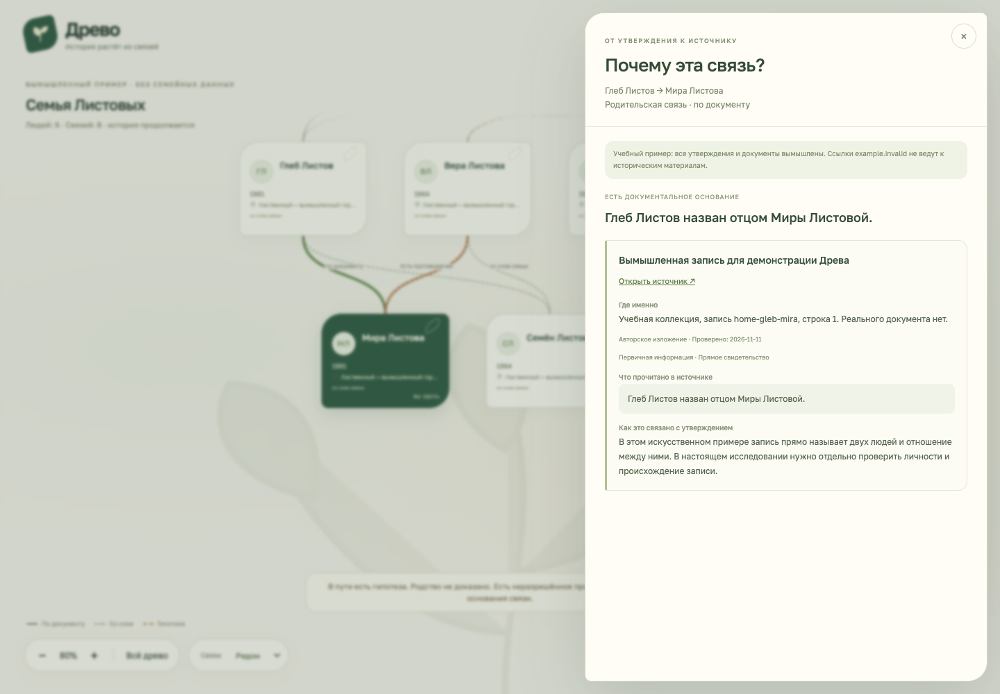

# Из исследовательского дела в дерево

В версии 0.2 `case.json` хранит людей и вопросы, `evidence.json` — отдельные утверждения и их основания. Команды создают из них локальный viewer. Не требуется повторно вручную переписывать родственные связи в формат рисовалки.

## Рабочий цикл

```bash
node bin/drevo.mjs audit ../my-family-case/evidence.json --case ../my-family-case/case.json
node bin/drevo.mjs tree-preview ../my-family-case
node bin/drevo.mjs tree-apply ../my-family-case
node bin/drevo.mjs tree-undo ../my-family-case
```

`tree-preview` перечисляет добавленных, изменённых и убранных людей/связи. Полная проекция и значения **до/после** лежат в `.drevo/tree-preview.json`, раздел `diff.details`. Просмотрите их перед применением. `--json` удобен для агента.

`tree-apply` принимает только актуальный предпросмотр: изменения дела, свидетельств или текущего дерева требуют нового просмотра. Команда создаёт и собирает отдельный viewer, а затем атомарно переключает указатель текущей версии. При неудаче прежняя версия остаётся на месте. Адрес папки viewer напечатается в результате; запустите в ней `npm run dev`, затем откройте выданный локальный URL.

`tree-undo` возвращает предыдущую применённую версию **отображения**. `case.json`, `evidence.json`, документы и все созданные версии сохраняются. При откате первой версии текущий указатель становится пустым. Уже открытая вкладка/работающий сервер сами не переключаются: остановите старый сервер и запустите viewer по новому напечатанному пути.

Хранилище:

```text
my-family-case/
  case.json
  evidence.json
  .drevo/
    tree-preview.json
    current.json
    revisions/<id>/
      family.json
      receipt.json
      viewer/dist/
```

Это частная папка вне репозитория. История содержит личные данные даже после отката. Копируйте целиком дело для резервного хранения; не публикуйте `.drevo/`. Ручная правка сохранённой версии обнаруживается по хешу. Новые сведения вносите в дело и применяйте новым проходом. Одновременные изменения дерева блокируются; после аварийной остановки убедитесь, что процесс завершён, прежде чем удалять пустую `.drevo/lock`.

## Явные утверждения

Старый `schemaVersion: 1` сохраняется. Для связи добавьте в существующее утверждение:

```json
{
  "id": "father-of-p2",
  "personIds": ["p1", "p2"],
  "statement": "Содержание утверждения и его ограничение",
  "status": "family-story",
  "assertion": {
    "kind": "relationship",
    "from": "p1",
    "to": "p2",
    "relationshipType": "parent-child"
  },
  "tree": {"include": true},
  "evidence": [],
  "researchCoverage": [],
  "conflicts": [],
  "conclusion": null
}
```

В `parent-child`, `adoptive`, `guardian` направление — взрослый → ребёнок. `partner` и `sibling` симметричны. `from/to` должны существовать в `case.people` и `claim.personIds`. Связь не создаётся из отчества, совпадения фамилии или текстового рассказа автоматически. Стабильные ID людей не изменяйте при исправлении имени.

Включаются только утверждения с `tree.include: true`. Старая запись без `assertion` остаётся пригодна для исследования; для включения в дерево ей нужно явно указать участников и вид связи. Совпадающие отношения объединяют основания на **одной конкретной связи**. Два родителя могут иметь разные статусы и источники; совместное родительство не создаёт супружескую связь.

- `family-story` отображается как семейные сведения (`reported`).
- `documented` и `concluded` — документальная опора. Это не гарантия истинности.
- `hypothesis` и утверждения с открытым противоречием требуют `--include-hypotheses` при предпросмотре; связь остаётся пунктирной. Без флага соответствующее отношение/событие откладывается целиком, даже если рядом выбрано более уверенное утверждение. Противоречие нельзя спрятать вторым источником.
- `candidate` не включается. Человек-кандидат и отношения с ним остаются в деле до установления личности.
- `people[].tree.include: false` скрывает человека и зависимые отношения. Корневой человек должен присутствовать.



В панели человека и пути родства нажмите **«Почему эта связь?»**. Откроются утверждение, источник, локатор, прочтение, объяснение, противоречия и ограничения вывода. Ветви доступны также с клавиатуры. Формальная проверка не повышает статус утверждения самостоятельно.

## Даты и места событий

Для рождения/смерти:

```json
{
  "kind": "event",
  "personId": "p1",
  "event": "birth",
  "value": {"year": 1918, "approximate": true, "place": "Название места"}
}
```

В `value` допустимы `year`, точная `date` (`YYYY-MM-DD`), `yearCandidates` (несколько разных лет), `approximate`, `place`. Утверждение сохраняет обычные `personIds`, `status`, `evidence` и `tree`. Точная дата должна соответствовать календарю; альтернативные годы нельзя одновременно объявить одной точной датой.

В частной версии сводные `people[].birth/death` используются как исходные сведения. Выбранные утверждения о событии заменяют сводную дату с предупреждением. Разные годы сохраняются как альтернативы, приблизительность сохраняется. Две разные точные даты одного года останавливают построение: разрешите противоречие либо явно выберите представление только года. Точные исходные значения выбранных утверждений остаются в основаниях. Гипотеза о событии отмечает карточку как предположительную, даже если другие сведения человека документированы.

## Подготовка публичной версии

```bash
node bin/drevo.mjs tree-preview ../my-family-case --public
```

По умолчанию всё частное. Для публичной проекции нужны явные метки:

- `people[].tree.visibility: "public"` — разрешены имя и варианты имени. Сводные даты/места человека при этом **не публикуются**.
- `claims[].tree.visibility: "public"` — разрешены конкретное утверждение и его основание; включение в дерево по-прежнему требует `include: true`.
- `sources[].visibility: "public"` — разрешены публикуемые поля каждого использованного источника, включая источники противоречий. Если один из них не разрешён, утверждение пропускается целиком.
- `case.tree.visibility: "public"` — разрешено название дела; иначе используется нейтральное «Семейное древо».

Публичные даты и места берутся **только из прошедших эти условия утверждений о событиях**. Непубличные поля `notes`, пути оригиналов и произвольные свойства не переносятся. Типичные локальные пути в разрешённом содержимом блокируются. Это не автоматический поиск всех секретов: перед отметкой `public` просмотрите текст, включая прочтения, локаторы и выводы.

После проверки примените предпросмотр. Для размещения предназначена только папка `viewer/dist/` соответствующей версии. Команды сами ничего в интернет не отправляют. Фотографии документов/могил автоматически не копируются: права и разрешённый состав изображений проверяются отдельно. Публикация семейных материалов остаётся отдельным поручением.

## Воспроизводимый учебный проход

Создайте новое дело командой `init` и замените в нём два JSON учебными `templates/case.example.json` и `templates/evidence.example.json` из репозитория. Они содержат только вымышленных людей и несуществующий источник `example.invalid`.

Выполните `tree-preview`, затем `tree-apply`, откройте viewer и нажмите «Почему эта связь?» у связи Сергея с Верой. Измените учебное утверждение, повторите цикл и выполните `tree-undo`: восстановится предыдущая версия, а исследовательские файлы сохранят изменения. Эти действия проверяются автоматическими тестами; существующие реальные дела при проверке не используются.
