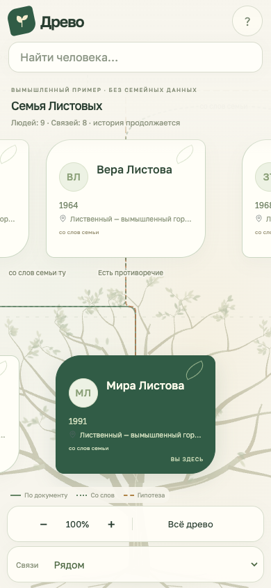
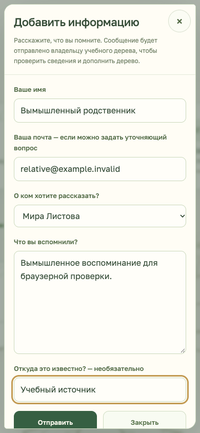

# Свой сайт и дополнения от родственников

«Древо» можно разместить как обычный статический сайт. Родственник открывает ссылку, выбирает человека и отправляет воспоминание владельцу. Владелец проверяет сообщение и добавляет сведения в семейное дело; форма сама не меняет факты и связи.

Есть два способа доставки: FormSubmit на почту без своего сервера или HTTPS-обработчик владельца, который направляет сообщения в удобное ему место. В исходном шаблоне и открытом демо форма **выключена**: там нет получателя, личной почты или рабочего адреса чужого дерева.

## 1. Подготовить отдельную версию сайта

Нужен Node.js 22 или новее. Клонируйте продукт; семейное дело и сайт держите вне его папки:

```sh
git clone https://github.com/AlekseiUL/drevo.git
cd drevo
# Если дела ещё нет:
node bin/drevo.mjs init ../my-family-case
```

Заполните дело и явно разрешите публикацию выбранных людей, утверждений, источников и вложений по [правилам публичной проекции](case-to-tree.md). Разрешение имени не разрешает автоматически биографию, даты, фотографии или документы. Для вложений отдельно задаются разрешения описания и файла, а также права на распространение: [досье человека](person-dossier.md).

```sh
node bin/drevo.mjs tree-preview ../my-family-case --public
# Прочитайте diff.details, предупреждения и family
# в ../my-family-case/.drevo/tree-preview.json
node bin/drevo.mjs tree-apply ../my-family-case
```

`tree-apply` напечатает строку `Viewer: /…/viewer`. Скопируйте **только эту папку** в новую папку сайта, например `../my-family-site`. Путь ниже замените напечатанным; существующую папку не перезаписывайте:

```sh
cp -R /PATH/PRINTED/BY/TREE-APPLY/viewer ../my-family-site
cd ../my-family-site
npm run dev
```

Папки версий внутри `.drevo/revisions/` служат историей — не редактируйте их. Работа идёт в отдельной копии сайта. Проверьте каждую карточку и материалы. Веб-сервер разработки слушает только `127.0.0.1`: это локальная проверка, а не опубликованный сайт.

Для первого знакомства вместо собственного дела можно создать отдельный сайт с вымышленной семьёй командой из папки продукта:

```sh
node skills/family-tree-studio/scripts/create-project.mjs --out ../practice-tree
```

## 2. Настроить доставку на почту

В копии сайта откройте `src/feedback-config.json`. По умолчанию там:

```json
{ "enabled": false, "ready": false }
```

Для FormSubmit:

```json
{
  "enabled": true,
  "ready": true,
  "provider": "formsubmit",
  "endpoint": "https://formsubmit.co/ajax/REPLACE_WITH_CONFIRMED_FORM_ID",
  "recipientName": "владельцу дерева"
}
```

`recipientName` — подпись в дательном падеже, например «хранителю семейного архива». Она не задаёт получателя: получатель определяется адресом `endpoint`.

1. Зарегистрируйте форму по [инструкции FormSubmit](https://formsubmit.co/documentation) и подтвердите свою почту из письма активации. После подтверждения сервис предоставляет строку формы, которой можно заменить открытый email в адресе.
2. Вставьте собственную строку вместо `REPLACE_WITH_CONFIRMED_FORM_ID`. Это публичный адрес приёма, а не секрет авторизации. Нельзя вставлять API-ключи, пароли или секретные webhook-токены: весь конфиг доступен посетителям.
3. Сначала включите форму в своей тестовой копии сайта. Отправьте короткое вымышленное сообщение и **проверьте письмо в своём ящике**. Настройку реальной доставки выполняет владелец сайта; тесты продукта никому писем не отправляют.
4. После подтверждённой доставки опубликуйте ту же настройку для родственников. Пока настройка не закончена, оставляйте `ready: false` в доступной им версии.

Форма принимает имя, необязательную почту для ответа, человека из дерева, воспоминание и источник. Для фото или документа можно указать ссылку; **загрузки файлов через эту форму пока нет**. Владелец может запросить оригинал ответным письмом, затем прикрепить его в локальном досье.

FormSubmit — внешний сервис: текст и обратная почта передаются ему. Клиент не отключает CAPTCHA через `_captcha`; поле-ловушка и ограничения длины дополняют защиту провайдера. Поведение AJAX и условия сервиса проверяйте перед настройкой по [официальной документации](https://formsubmit.co/ajax-documentation). Ссылки на документацию сверены 12.11.2026.

## 3. Направлять сообщения в свой обработчик

Если у вас уже есть сервер или система автоматизации, выберите явный режим `webhook`:

```json
{
  "enabled": true,
  "ready": true,
  "provider": "webhook",
  "endpoint": "https://receiver.example.invalid/family/inbox",
  "recipientName": "хранителю семейного архива"
}
```

Замените пример своим публичным HTTPS-адресом приёма. Он должен принимать `POST` с `Content-Type: application/json`:

```json
{
  "schemaVersion": 1,
  "sender": { "name": "Вымышленный родственник", "email": "relative@example.invalid" },
  "person": { "id": "fictional-person", "name": "Вымышленный человек" },
  "tree": { "title": "Учебное дерево", "url": "https://example.invalid/tree/#person=fictional-person" },
  "message": "Вымышленное воспоминание для проверки.",
  "source": "Учебная запись"
}
```

Для рассказа о семье в целом `person.id` пустой; необязательные `sender.email` и `source` тоже могут быть пустыми. Все входящие поля — пользовательский текст, не HTML. Сервер обязан проверять длину/формат, ограничивать поток запросов и безопасно хранить сообщения. Ключи почты, бота или CRM хранятся **только на сервере**. Готового сервера отправки в комплекте нет: этот режим — документированный интерфейс подключения вашего обработчика.

После сохранения сообщения или постановки в надёжную очередь обработчик возвращает HTTP 2xx и JSON `{"success":true}`. При ошибке — соответствующий HTTP-статус и/или `{"success":false}`. Один HTTP 200 не считается успехом. Для другого домена обработчик должен отвечать на CORS preflight `OPTIONS`, разрешать origin вашего сайта, метод `POST` и заголовок `Content-Type`. Cookies и HTTP-авторизацию клиент не передаёт. Запросы не повторяются автоматически; тайм-аут не доказывает, что сервер не успел сохранить сообщение.

## 4. Собрать и разместить

Из отдельной папки сайта:

```sh
npm run build
npm run preview
```

На любой статический HTTPS-хостинг загрузите **только содержимое `dist/`**. Это готовые HTML/CSS/JS, разрешённые данные и выбранные материалы. Не загружайте семейное дело, `.drevo`, `originals`, переписку или всю рабочую папку. Если хостинг связан с публичным GitHub-репозиторием, опубликованные в нём данные также видны всем; для личного дерева выбирайте отдельное размещение с подходящим доступом.

Сайт можно разместить и в подпапке, например `/family/`: пути к данным и скриптам относительные. GitHub Pages может отдавать готовые файлы; обработчик почты/сообщений работает отдельно. Встроенного разграничения доступа у статического viewer нет. «Только по ссылке» не является паролем; для ограниченного доступа используйте авторизацию хостинга.

Если хостинг задаёт Content Security Policy, разрешите в `connect-src` собственный сайт и origin выбранного получателя, например `connect-src 'self' https://formsubmit.co`. Не разрешайте произвольные домены. Для запроса используется `strict-origin-when-cross-origin`: внешнему сервису передаётся origin сайта без пути и query-параметров в `Referer`. В самом сообщении остаётся путь к дереву и выбранный `#person`, а query и лишние параметры фрагмента удаляются. Проверьте отправку с окончательного адреса сайта — настройки хостинга могут влиять на неё.

После обновления семейного дела снова выполните публичные `tree-preview` → проверку → `tree-apply`, скопируйте новую viewer-папку в **новую** папку сайта, перенесите только проверенный `feedback-config.json` и соберите. Это сохраняет историю версий и предотвращает случайное добавление частных материалов в прежнюю публикацию.

## Что получает родственник

Кнопка «Добавить информацию» есть над деревом и в карточке человека. Из карточки человек выбирается автоматически; незавершённый рассказ сохраняет прежний выбор. При ошибке текст остаётся в форме, а закрытие и повторное открытие не стирают его. Черновик хранится только в этой вкладке, до перезагрузки; браузер предупреждает о выходе с несохранённым текстом. Успех означает приём сообщения сервисом, а не доказанную доставку письма и не публикацию нового семейного факта.

На телефоне есть читаемый начальный масштаб, перемещение, масштабирование двумя пальцами и прокрутка карточки/формы. «Всё древо» показывает общий обзор. Поколения расположены рядами; отдельно показаны люди, чья связь с основной семьёй пока не установлена.

| Дерево на телефоне | Дополнение о выбранном человеке |
| --- | --- |
|  |  |

## Проверки для разработчика

```sh
node --test test/feedback.test.mjs
node test/browser-feedback-check.mjs --playwright-module /path/to/playwright/index.mjs --channel chrome
node test/browser-mobile-check.mjs --playwright-module /path/to/playwright/index.mjs --channel chrome
```

Браузерная проверка формы использует вымышленные данные и перехватывает запросы к получателю: никакой почты, ботов и частных сайтов. Она проверяет успешный приём, отказ, сохранение текста, выбор человека, отключённую конфигурацию и мобильный экран. Доставку реального провайдера отдельно проверяет владелец своей настроенной копии.
